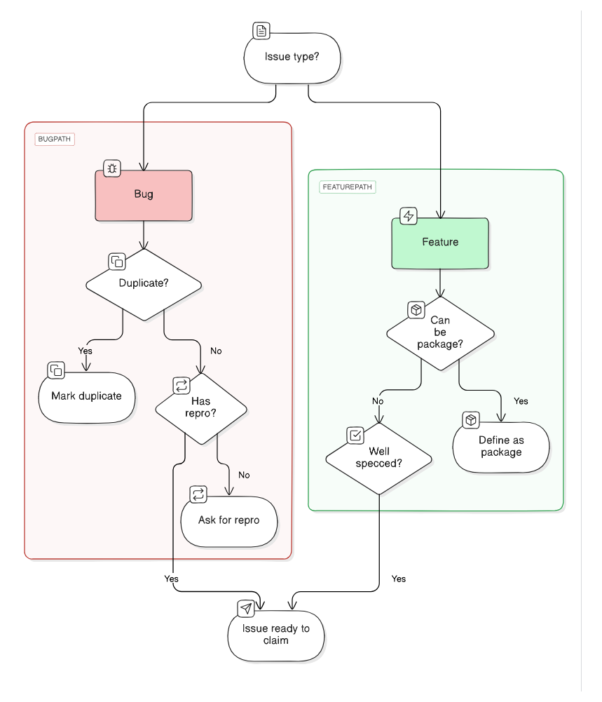

<p><a target="_blank" href="https://app.eraser.io/workspace/BoEsyHgI5kwLS9hqZiE8" id="edit-in-eraser-github-link"></a></p>

## wc
File Statistics

### Options
```
-f, --file string   file to read
-h, --help          help for wc
```
### SEE ALSO
- [wc characters](wc_characters.md)  - count by characters
- [wc completion](wc_completion.md)  - Generate the autocompletion script for the specified shell
- [wc lines](wc_lines.md)  - count by lines
- [wc words](wc_words.md)  - count by words
###### Auto-generated by spf13/cobra on 25-Nov-2023
[View on canvas](https://app.eraser.io/workspace/BoEsyHgI5kwLS9hqZiE8?elements=lThGx5pVT0pqzv55-rixIQ) 


<!-- eraser-additional-content -->
## Diagrams
<!-- eraser-additional-files -->
<a href="/docs/wc-flowchart-1.eraserdiagram" data-element-id="bwwEi-Age9h0dSTTW0nxN"></a>
<!-- end-eraser-additional-files -->
<!-- end-eraser-additional-content -->
<!--- Eraser file: https://app.eraser.io/workspace/BoEsyHgI5kwLS9hqZiE8 --->